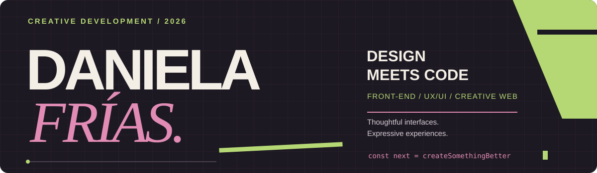
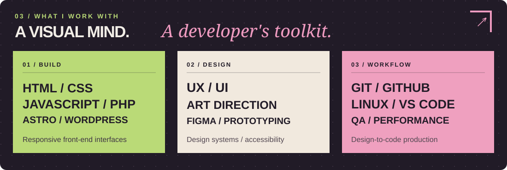
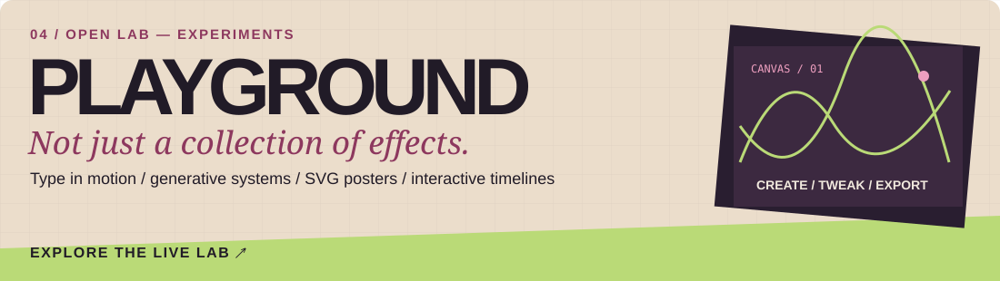
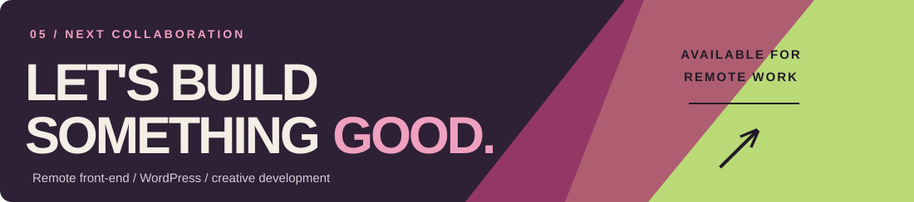

 

**CREATIVE FRONT-END DEVELOPER** &nbsp; / &nbsp; **UX/UI DESIGNER** &nbsp; / &nbsp; **WEB EXPERIENCES**

Based in Caracas, Venezuela · Working remotely with international teams

[**EXPLORE THE PORTFOLIO ↗**](https://daniela-frias-creative-developer.pages.dev/en/) &nbsp;&nbsp;·&nbsp;&nbsp; [**VIEW IN SPANISH ↗**](https://daniela-frias-creative-developer.pages.dev/es/) &nbsp;&nbsp;·&nbsp;&nbsp; [**EMAIL ME ↗**](mailto:briefcase.df@gmail.com)

---

### 01 / THE INTRO

## Design with character. Code with purpose.

I'm a front-end developer and UX/UI designer with **13+ years of experience** across visual communication, digital design, and web production. I bring creative direction and implementation together to build distinctive, responsive websites—from editorial experiences to custom WordPress interfaces.

My approach balances expressive typography and thoughtful interaction with accessibility, performance, and the technical details that make a website work beautifully.

`VISUAL THINKING` &nbsp; × &nbsp; `FRONT-END DEVELOPMENT` &nbsp; × &nbsp; `CREATIVE INTERACTION`

---

### 02 / SELECTED WORK

**Six projects. Six visual directions. One consistent standard of craft.**  
Explore the case studies on my bilingual portfolio.

<table>
<tr>
<td width="50%" valign="top">

 <b>01 — LUNARIA</b> Editorial beauty experience · <code>Astro</code> 
<a href="https://daniela-frias-creative-developer.pages.dev/en/work/lunaria/">Explore case study ↗</a>
</td>
<td width="50%" valign="top">

 <b>02 — THREADLAB</b> Experimental fashion-tech interface · <code>Astro</code> 
<a href="https://daniela-frias-creative-developer.pages.dev/en/work/threadlab/">Explore case study ↗</a>
</td>
</tr>
<tr>
<td width="50%" valign="top">

 <b>03 — SYNOVA</b> Healthcare identity and digital expression · <code>SvelteKit</code> 
<a href="https://daniela-frias-creative-developer.pages.dev/en/work/synova/">Explore case study ↗</a>
</td>
<td width="50%" valign="top">

 <b>04 — VINEWINNER</b> Wine commerce and discovery concept 
<a href="https://daniela-frias-creative-developer.pages.dev/en/work/vinewinner/">Explore case study ↗</a>
</td>
</tr>
<tr>
<td width="50%" valign="top">

 <b>05 — HERB AGENCY</b> Brand expression and creative web design 
<a href="https://daniela-frias-creative-developer.pages.dev/en/work/herb-agency/">Explore case study ↗</a>
</td>
<td width="50%" valign="top">

 <b>06 — SHUTTLEFLOW</b> Enterprise mobility and B2B interfaces 
<a href="https://daniela-frias-creative-developer.pages.dev/en/work/shuttleflow/">Explore case study ↗</a>
</td>
</tr>
</table>

---

### 03 / THE TOOLKIT

Also exploring: creative coding, Canvas, SVG, motion, SvelteKit and modern application architecture. Specific project implementations are documented in their case studies.

---

### 04 / THE PLAYGROUND

[**ENTER THE INTERACTIVE PLAYGROUND ↗**](https://daniela-frias-creative-developer.pages.dev/en/playground/)

---

### 05 / LET'S MAKE IT REAL

**Thoughtful design. Clean implementation. Strong creative direction.**  
Open to remote roles and long-term collaborations with async-friendly international teams.

[**✦ PORTFOLIO ↗**](https://daniela-frias-creative-developer.pages.dev/en/) &nbsp;&nbsp; / &nbsp;&nbsp; [**✉ EMAIL ME ↗**](mailto:briefcase.df@gmail.com) &nbsp;&nbsp; / &nbsp;&nbsp; [**DESIGN ARCHIVE ↗**](https://briefcasedf.wixsite.com/ux-ui)

🇪🇸 ¿Prefieres español? Explora mi <a href="https://daniela-frias-creative-developer.pages.dev/es/">portafolio en español</a>.

 

© 2026 DANIELA FRÍAS &nbsp; · &nbsp; DESIGNED WITH INTENTION. BUILT WITH CODE.

